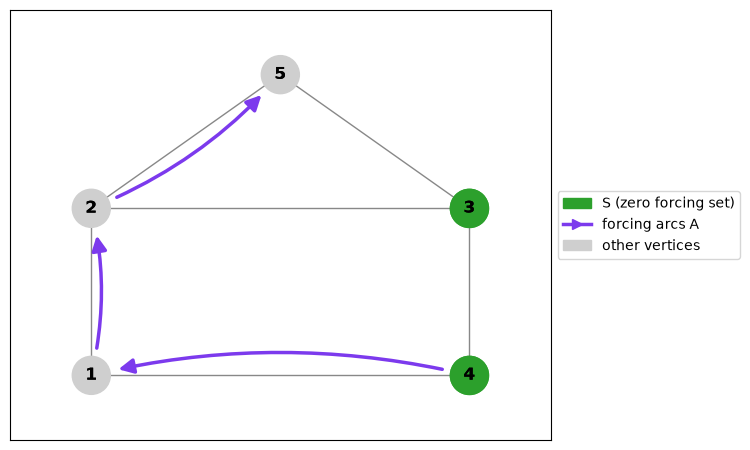
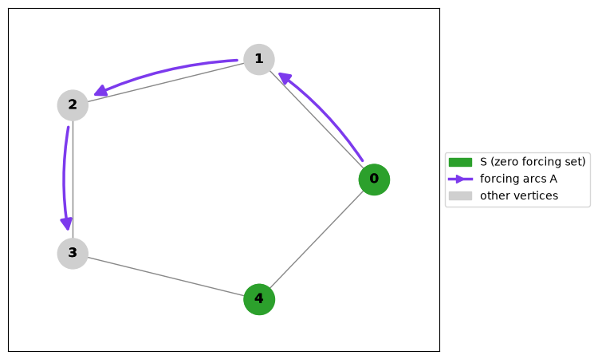
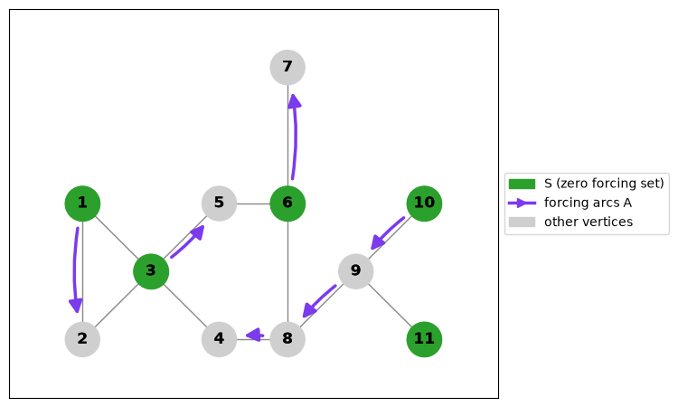

# zf-approx

A standard-library-only Python implementation of the deterministic approximation
algorithm for the **zero forcing number** from

> {B. Cameron, J. Janssen, R. Mathew, Z. Zhang (2025) An approximation algorithm for zero forcing, *Discrete Applied Mathematics*, **383**, 227--242, https://www.sciencedirect.com/science/article/pii/S0166218X2500722X. 

Given a graph and a path decomposition of width `w`, the algorithm returns a zero forcing set `S`, a fort packing `F`, and the forcing arcs `A`, with the guaranteed bound

    |S| ≤ (w + 1) · |F|.

Because `|F| ≤ Z(G) ≤ |S|`, the returned set is a `(w + 1)`-approximation of the zero forcing number `Z(G)`; with an optimal decomposition (`w = pw(G)`) this is the paper's pathwidth-based approximation ratio. The core trusts suitable inputs and contains no validation; a thin outer layer checks them (connected graph; bags form a path decomposition) and nicifies the decomposition before running the algorithm.

## Install

Requires Python ≥ 3.10. From a clone:

    git clone https://github.com/OwenZZY/CJMZ_ZF.git
    cd CJMZ_ZF
    pip install -e .

The package's only runtime dependency is `networkx`: the public entry point takes a NetworkX graph (it reads `graph.nodes` and `graph.edges`, so any object exposing those attributes works). The notebook additionally uses `matplotlib` for its figures; install both extras with `pip install -e ".[demo]"`.

`python3 examples.py` runs self-checking worked examples (standard library only).

## Quickstart

    pip install -e ".[demo]"   # package + notebook extras (networkx, matplotlib)

```python
import networkx as nx
import zf

G = nx.Graph()
G.add_edges_from([(1, 2), (2, 3), (3, 4), (1, 4), (2, 5), (3, 5)])  # the "house"
bags = [{1, 4}, {1, 3, 4}, {1, 2, 3}, {2, 3, 5}]   # a path decomposition; need not be nice

r = zf.zf_via_path_decomp(G, bags)
print(r.zf_set)   # (3, 4)
print(r.forts)    # (frozenset({1, 2, 3, 4}),)
print(r.arcs)     # ((1, 2), (2, 5), (4, 1))

## Spec Coding

This notebook demonstrates the `zf` package. The implementation was produced in a spec-coding workflow with DeepSeek V4.1 Flash (`deepseek-v4.1-flash-1017`) and Qwen 4 Max (`qwen4-max-preview`), used for specification review, implementation, and checking; all algorithmic decisions and final verification are the authors'. The specification it was implemented against is [`SPEC-v1.md`](SPEC-v1.md).


```python
import sys


import networkx as nx
import matplotlib.pyplot as plt
from matplotlib.patches import Patch
from matplotlib.lines import Line2D
import zf

%matplotlib inline


def report(r, bags):
    """Line-by-line results, with the guarantee bound aligned and checked."""
    w = max(map(len, bags)) - 1
    nS, nF = len(r.zf_set), len(r.forts)
    print(f"S        = {r.zf_set}")
    print(f"forts    = {[sorted(f) for f in r.forts]}")
    print(f"arcs     = {r.arcs}")
    print(f"|S|      = {nS}")
    print(f"w        = {w}")
    print(f"|F|      = {nF}")
    print(f"(w+1)|F| = {(w + 1) * nF}")
    print(f"|S| <= (w+1)|F| : {nS} <= {(w + 1) * nF}  "
          f"{'OK' if nS <= (w + 1) * nF else 'VIOLATED'}")


def present(G, pos, r):
    """One figure per case: S green, forcing arcs purple arrows.
    The explanation lives in the legend (outside the axes, never over nodes)."""
    S = set(r.zf_set)
    fig, ax = plt.subplots(figsize=(7.6, 4.6 if G.number_of_edges() else 2.8))
    colors = ["#2ca02c" if v in S else "#cfcfcf" for v in G.nodes]
    nx.draw_networkx(G, pos, ax=ax, node_color=colors, node_size=750,
                     font_weight="bold", edge_color="#888888")
    if r.arcs:
        nx.draw_networkx_edges(G, pos, edgelist=list(r.arcs), ax=ax,
                               edge_color="#7c3aed", width=2.5, arrows=True,
                               arrowstyle="-|>", arrowsize=22,
                               connectionstyle="arc3,rad=0.12",
                               min_source_margin=20, min_target_margin=20)
        nx.draw_networkx_nodes(G, pos, nodelist=sorted(S), ax=ax,
                               node_color="#2ca02c", node_size=750)
        nx.draw_networkx_labels(G, pos, ax=ax, font_weight="bold")
    ax.legend(handles=[Patch(color="#2ca02c", label="S (zero forcing set)"),
                       Line2D([0], [0], color="#7c3aed", lw=2.5, marker=">",
                              markersize=7, label="forcing arcs A"),
                       Patch(color="#cfcfcf", label="other vertices")],
              loc="center left", bbox_to_anchor=(1.0, 0.5))
    ax.margins(0.15)
    fig.tight_layout()
    plt.show()
```


```python
G = nx.Graph()
G.add_nodes_from([1, 2, 3, 4, 5])
G.add_edges_from([(1, 2), (2, 3), (3, 4), (1, 4),   # the square
                  (2, 5), (3, 5)])                  # the roof
pos = {1: (0, 0), 2: (0, 1), 3: (1, 1), 4: (1, 0), 5: (0.5, 1.8)}
bags = [{1, 4}, {1, 3, 4}, {1, 2, 3}, {2, 3, 5}]    # width 2, not nice

r = zf.zf_via_path_decomp(G, bags)
report(r, bags)          # <- replaces the two print lines and the w = ... line
present(G, pos, r)
```

    S        = (3, 4)
    forts    = [[1, 2, 3, 4]]
    arcs     = ((1, 2), (2, 5), (4, 1))
    |S|      = 2
    w        = 2
    |F|      = 1
    (w+1)|F| = 3
    |S| <= (w+1)|F| : 2 <= 3  OK


    

    


```python
G = nx.cycle_graph(5)                               # nodes 0..4
pos = nx.circular_layout(G)
bags = [{0, 1}, {0, 1, 2}, {0, 2, 3}, {0, 3, 4}]    # width 2, not nice

r = zf.zf_via_path_decomp(G, bags)
print("S =", r.zf_set, "| forts =", [sorted(f) for f in r.forts], "| arcs =", r.arcs)
w = max(map(len, bags)) - 1
print(f"guarantee: |S| = {len(r.zf_set)} <= ({w}+1)*{len(r.forts)} = {(w+1)*len(r.forts)}")
present(G, pos, r)

```

    S = (0, 4) | forts = [[0, 1, 2, 3]] | arcs = ((0, 1), (1, 2), (2, 3))
    guarantee: |S| = 2 <= (2+1)*1 = 3


    

    


```python
"""
Input contract: 
 The outside layer requires a **connected** graph and bags that form a path
 decomposition (D1 edge coverage, D2 contiguity, every vertex covered). The cell
 below deliberately violates connectedness: the call halts with `ValueError`.
 The core itself trusts its inputs and raises nothing.
"""

G = nx.Graph()
G.add_nodes_from(["a", "b"])
pos = {"a": (0, 0), "b": (1, 0)}
bags = [{"a"}, {"b"}]                               # width 0; each isolate its own fort

r = zf.zf_via_path_decomp(G, bags)
report(r, bags)          # <- replaces the two print lines and the w = ... line
present(G, pos, r)
```


    ---------------------------------------------------------------------------

    ValueError                                Traceback (most recent call last)

    Cell In[4], line 14
         10 G.add_nodes_from(["a", "b"])
         11 pos = {"a": (0, 0), "b": (1, 0)}
         12 bags = [{"a"}, {"b"}]                               # width 0; each isolate its own fort
         13 
    ---> 14 r = zf.zf_via_path_decomp(G, bags)
         15 report(r, bags)          # <- replaces the two print lines and the w = ... line
         16 present(G, pos, r)


    File ~/DeepSeekHarness/zf-approx/zf/api.py:155, in zf_via_path_decomp(graph, bags)
        136 """Return a zero forcing set and a fort packing of ``graph``.
        137 
        138 Zero forcing via a path decomposition (the approximation algorithm
       (...)    152 bags and F the returned fort packing.
        153 """
        154 if not _is_connected(graph):
    --> 155     raise ValueError(
        156         "graph is not connected; the outside API requires a connected "
        157         "graph (the paper's assumption); the core itself trusts inputs")
        158 if not _is_path_decomp(graph, bags):
        159     raise ValueError(
        160         "bags are not a path decomposition of the graph "
        161         "(need: bag elements are vertices, every vertex covered, "
        162         "D1 edge coverage, D2 contiguity)")


    ValueError: graph is not connected; the outside API requires a connected graph (the paper's assumption); the core itself trusts inputs


```python

H = nx.Graph()

E = [(1,2), (2,3), (1,3),
    (3,5), (5,6), (6,8), (4,8),   (3,4),
    (6,7), (8,9), (9, 10), (9,11)]
H.add_edges_from(E)
bags = [
    [],
    [1],
    [1, 2],
    [1, 2, 3],
    [2, 3],
    [3],
    [3, 4],
    [3, 4, 5],
    [4, 5],
    [4, 5, 6],
    [4, 6],
    [4, 6, 7],
    [4, 6],
    [4, 6, 8],
    [6, 8],
    [8],
    [8, 9],
    [9],
    [9, 10],
    [9, 10, 11],
    [10, 11],
    [11],
    []
]
pos = {1: (0, 2), 2: (0, 1), 3: (1, 1.5),
       4: (2, 1), 5: (2, 2),
       6: (3, 2), 7: (3, 3), 8: (3, 1),
       9: (4, 1.5), 10: (5, 2), 11: (5, 1)}

r = zf.zf_via_path_decomp(H, bags)
report(r, bags)          # <- replaces the two print lines and the w = ... line
present(H, pos, r)
```

    S        = (1, 3, 6, 10, 11)
    forts    = [[1, 2], [4, 5, 6, 7], [10, 11]]
    arcs     = ((1, 2), (3, 5), (6, 7), (8, 4), (9, 8), (10, 9))
    |S|      = 5
    w        = 2
    |F|      = 3
    (w+1)|F| = 9
    |S| <= (w+1)|F| : 5 <= 9  OK


    

    


```python

```

## Citation

If you use this implementation, please cite the paper:

> B. Cameron, J. Janssen, R. Mathew, Z. Zhang, *An approximation algorithm for zero forcing*,
> Discrete Applied Mathematics **383** (2025) 227--242. DOI [10.1016/j.dam.2025.12.013](https://doi.org/10.1016/j.dam.2025.12.013); arXiv [2402.08866](https://arxiv.org/abs/2402.08866).

A machine-readable record is in [`CITATION.cff`](CITATION.cff).

